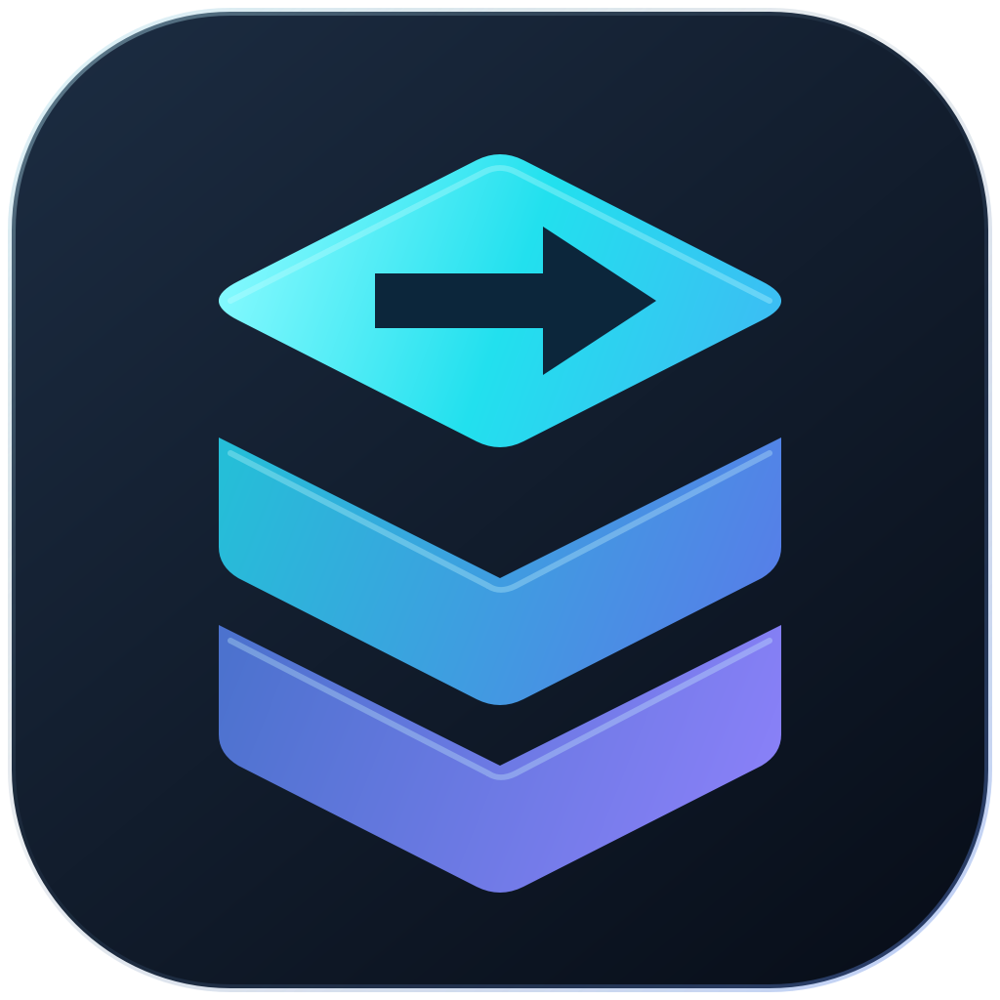

<div align="center">
  
  <h1>StrataCopy</h1>
  <p><strong>A compact Windows copy utility. Powered by Robocopy.</strong></p>
  <p>Modern controls, native Explorer integration, and transfer settings you can inspect.</p>
  <p>
    
    
    
    
  </p>
  <p><a href="https://github.com/SheedaMusalli/StrataCopy/releases/latest"><strong>Download latest release</strong></a> · <a href="#getting-started">Getting started</a> · <a href="#explorer-integration">Explorer integration</a> · <a href="#building-from-source">Build from source</a></p>
</div>

---

## What is StrataCopy?

StrataCopy brings Windows' built-in Robocopy engine into a small desktop interface. Add files or folders, pick a destination, and copy. Expand Details when you need the activity list and completion actions. Recent transfers appear on the main screen.

**v1.1.0 is the first official release.** Copy, move, mirror and dry-run operations run through the system `robocopy.exe`. StrataCopy manages the queue, process lifecycle, interface and optional readback verification.

## Features

| Area | Included in v1.1.0 |
| --- | --- |
| Compact interface | 640 × 450 dark copy window; expandable details; original icon; native move/resize and keep-on-top |
| Explorer integration | Optional handling of Ctrl+C/Ctrl+X → Ctrl+V, native Paste menus, command-bar Paste, and filesystem drag-and-drop |
| Transfer control | Pause, resume, cancel, estimated progress and speed graph; closes after success by default |
| Robocopy settings | Copy/move/mirror; existing-file rules; threading, retries, attributes, access, links, size, age and exclusions |
| Integrity checks | Optional XXH3-64, BLAKE3 or SHA-256 readback verification and mismatch reporting |
| Recovery and activity | Searchable bounded activity list, complete logs, SQLite queue recovery and 100 recent runs |
| Reusable setup | Built-in profiles, saved presets and persistent interface preferences |
| Distribution | Modern per-user Windows x64 installer; buildable source in this repository |

## Getting started

### Installer

1. Download **StrataCopy-1.1.0-Setup-x64.exe** from [Releases](https://github.com/SheedaMusalli/StrataCopy/releases/latest).
2. Run the installer. It installs for your account without requiring administrator access.
3. Choose the optional desktop shortcut, Explorer menu entries, and default copy handling.
4. Open StrataCopy, add files or folders, select a destination, and press **Copy**.

### Verify downloads

GitHub displays a SHA-256 digest beside the installer asset. Compare it with:

```powershell
Get-FileHash .\StrataCopy-1.1.0-Setup-x64.exe -Algorithm SHA256
```

## Using the copy window

**+ Files** and **+ Folder** add sources; dropping items onto the window also adds them. **Browse** chooses the destination. A selected source folder retains its name at the destination; loose files go directly into the destination folder.

**Details** opens the activity list, filters and completion actions. **Settings** includes compact/detailed startup layout, pinning, completion defaults, Explorer integration and transfer parameters. Drop additional files during a transfer to queue them for the same destination. The source list clears and transfer mode returns to All subfolders, including empty after each run.

The default **After copying** action is **Close window**, which runs only after a successful transfer. Choose **Keep open** in Details when you want to inspect the finished activity. Failed or cancelled transfers remain open.

Copy and move start without a command confirmation. Mirror asks before deleting destination extras. Existing-file decisions include a Do this for all conflicts checkbox, scoped to one transfer. Cancel stops further work but does not roll back completed copies.

### Existing files

The default **Ask for each existing file** mode pauses on filename conflicts, including files inside merged folders. The dialog shows the incoming and existing paths, sizes and dates, with three choices:

- **Replace Existing File** copies the incoming file over that destination file.
- **Skip This File** preserves the existing destination and leaves the source untouched.
- **Make Duplicate** preserves the existing destination and creates a numbered incoming copy, such as `report (2).txt`. Occupied numbers are skipped without overwriting them.

Cancel stops the remaining transfer. Source contents are copied by Robocopy; duplicate naming uses an atomic rename within the destination filesystem. If a duplicate cannot be published after copying/moving, its staged data is retained and the recovery path is reported. Settings → **Existing files** also offers explicit automatic policies: delta copy, keeping newer destination files, skipping existing files, or overwriting without individual prompts.

## Explorer integration

Enable **Settings → Set StrataCopy as default copy handler**, or select the corresponding installer option. Uncheck it to restore Windows copying for subsequent Explorer operations. The choice persists across sign-ins and installer upgrades. Separate **Copy with StrataCopy** and **Paste with StrataCopy** actions can be added under Windows 11's **Show more options** menu.

Native Copy and Cut still populate Explorer's clipboard. The helper loads `StrataCopyNative-1.1.0.dll` into x64 Explorer using thread-specific message hooks. The DLL intercepts normal `IFileOperation` copy/move requests and queues them for StrataCopy. No Windows system files are replaced, and there is no global keyboard hook.

Requests are saved atomically before handoff. Requests received while busy or awaiting confirmation remain queued. Acceptance means StrataCopy owns an asynchronous transfer; its window reports progress and failures.

### Integration boundaries

- Normal filesystem copy/move is supported. Phones, ZIP namespaces and other virtual shell items use Windows.
- Unsupported changed target names, same-folder duplicate naming, reparse-point sources, overlapping trees, mixed batches, multiple destinations and over-limit requests use Windows.
- Other apps and privileged helpers may use different copy paths. This does not replace every file operation in every application.
- Intercepted transfers do not create Explorer Undo entries. Review saved queue/history after a crash.
- Disabling stops interception immediately. Native modules stay loaded until Explorer exits to avoid unloading code still in use. Upgrades or uninstall may require sign-out/restart to remove a locked module.

## Updates

**Settings → Check for Updates** requests GitHub's latest stable release and compares its version with the installed app. If current, StrataCopy displays an up-to-date message. If a newer version exists, it opens [the latest release](https://github.com/SheedaMusalli/StrataCopy/releases/latest) in your browser. Connection errors and rate limits are reported separately. Checking is asynchronous, has a 15-second timeout, and does not silently install software.

## Building from source

The scripts use Qt 6.8.3 and MinGW 13.1 in the workspace-local `.tools` directory. On a fresh checkout, provide Python 3.10+:

```powershell
.\scripts\bootstrap.ps1 -Python 'C:\path\to\python.exe'
.\scripts\build.ps1 -Deploy
```

Alternatively use CMake 3.24+ with matching Qt/compiler installations. Required Qt components: Core, Gui, Quick, QuickControls2, ShaderTools, Network, Sql, Concurrent and Test. The renderer probe uses version-specific `Qt6::GuiPrivate` headers; build and deploy against matching Qt libraries. Set `QT_ROOT` for an alternate Qt installation. An MSVC build requires an MSVC Qt kit.

For the installer, install Inno Setup at `.tools/InnoSetup/ISCC.exe` or make it available on PATH:

```powershell
.\scripts\build-installer.ps1 -SkipBuild
.\scripts\test-installer.ps1
.\scripts\package.ps1 -SkipBuild
```

The default build runs both suites and rejects skipped tests. Stop the Explorer helper before testing the actual app handoff. Timed UI QA controls are compiled out of production; `-UiTestHooks` enables them for a diagnostic build.

### Source layout

```text
src/Core/          Commands, process supervision, scanning and telemetry
src/Platform/      Windows integration, resource ownership and Explorer hook
src/UI/            Qt Quick interface, models and coordinator
src/Persistence/   SQLite queue, presets and history
src/Verification/  Post-copy hashing
resources/         Original artwork, Windows resources and shaders
tests/             Engine, coordinator and native integration checks
installer/         Inno Setup project
scripts/           Bootstrap, build, packaging and installer validation
third_party/       Vendored dependencies and license notices
```

## Memory management and validation

Native handles and retained COM arguments use RAII. Shutdown joins worker threads; process jobs terminate owned children. Queue/model budgets limit retained activity, while complete output streams to disk. Graphs retain 600 samples, incomplete parser lines are capped, and hashing reuses scoped buffers.

All **40 required engine/native checks passed with zero skips** for v1.1.0, including actual Robocopy transfers, all conflict choices, nested conflicts, duplicate moves, cancellation while awaiting a decision, hash verification, network/version comparisons, timeouts, recovery, native fallback, abandoned operations, concurrent apartments and the real application handoff. Installer validation checks install, upgrade, optional registrations and uninstall cleanup. Resource-growth checks are not a full heap-profiler proof of zero leaks. See [validation](VALIDATION.md) and [ownership review](MEMORY_REVIEW.md).

## Data and diagnostics

The default journal and logs are under `%LOCALAPPDATA%/StrataCopy/StrataCopy/`. The UI diagnostic log is `%TEMP%/stratacopy-ui.log`. History timestamps use UTC.

| Variable | Purpose |
| --- | --- |
| `STRATACOPY_DATA_DIR` | Override journal and request location |
| `STRATACOPY_DIAGNOSTICS` | Override the UI diagnostic log |
| `STRATACOPY_RENDERER` | Select a renderer, such as `d3d11` or `software` |
| `STRATACOPY_EXPLORER_TRACE=1` | Enable bounded diagnostics when starting the helper |

## Known limitations

Progress, ETA and process-I/O rates are estimates. Activity classification recognizes English Robocopy labels; other languages retain raw logs. Source reparse points are excluded from pre-scan/verification; copying follows the chosen Robocopy link flags. Hash verification is unavailable for moves and skeleton copies. An unavailable network share can delay shutdown while a filesystem call is blocked.

The bundled MinGW Qt build uses D3D11 or software rendering after probing; it has no working D3D12 backend. DWM effects depend on Windows support. No fixed speed or frame-rate guarantee is made.

## Dependencies and notices

Qt is dynamically linked. License texts accompany the distribution; matching Qt source locations are listed in [THIRD_PARTY_NOTICES.md](THIRD_PARTY_NOTICES.md). Vendored xxHash, BLAKE3 and MinHook retain their own licenses. GCC runtime notices are included. Windows supplies Robocopy, which is not redistributed. The editable original logo is in [resources/icons](resources/icons).

Report bugs in [Issues](https://github.com/SheedaMusalli/StrataCopy/issues) with your Windows version, reproduction steps and relevant errors. Review logs for personal paths before sharing them.

Right-click the StrataCopy tray icon and select **Show window only during transfers** for a Windows-style workflow. This preference hides the idle window and its Copy button; progress and conflict windows appear during transfers. Clear the option for the normal interface with its Copy button. Open StrataCopy and Settings remain available in the tray menu. Successful Explorer transfers clear the destination as well as the source list.

Successful transfers show a small Steam-style completion notification near the bottom-right of the transfer screen, with total elapsed time. It slides in without taking focus, stays for about five seconds and can be dismissed. It also works when tray-only mode hides the copy window.

### Hardware-aware performance
The installer records local CPU, RAM and fixed-drive types in the application data folder. Auto (recommended) rechecks source and destination storage for each transfer and uses the lower thread limit: HDD/USB/unknown up to 4, SSD/network up to 8, NVMe up to 32. Low-core and low-memory machines receive lower limits. These are conservative heuristics, not measured optimal throughput or guaranteed lag-free settings.

Settings → Performance profile offers Auto, Safe / Silent (4), NVMe Extreme (32, no retries), and Manual (1–128). Changing worker threads selects Manual. Explorer transfers retain the selected performance policy. Auto does not run benchmarks or change its thread count in the middle of a transfer. General defaults use buffered I/O; unbuffered I/O remains available for large files. File activity logging, conflicts and verification remain supported. Archive streaming is not part of this feature.

### Deleting with StrataCopy
With Explorer integration enabled, Delete and the Explorer Delete menu request recycling; Shift+Delete requests permanent deletion. StrataCopy confirms the selected paths before starting, reports progress, supports cancellation and records the outcome in history. Permanent deletion is explicitly labeled and cannot be undone. If recycling is unavailable, Windows asks before permanent removal. Unsupported/mixed shell operations retain Windows handling.

Copy/move use Robocopy. Deletion uses a dedicated background Windows Shell batch; it is not guaranteed faster than native Explorer deletion. Thread-count profiles apply to copying, not this deletion worker. Cancellation cannot restore items already deleted. Folder junctions are not traversed by default; root deletion is rejected.
